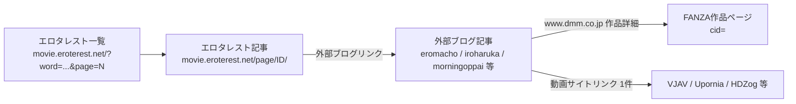

# 調査メモ・運用知見（findings）

最終更新: 2026-11-22
対象: `use-playwright`（収集パイプライン）
関連: `docs/plan.md`（設計・計画）、本ファイル（実測・運用ノウハウ）

---

## 0. コンテキスト復帰用サマリー

- 実行環境: VPS。ブラウザプロファイル `.browser-data` を全スクリプトで共有するため**直列実行**が必須
- 実装済み:
  - S0 検索設定（7サイトのみ表示する設定を**適用済み**）
  - S1 一覧収集（`src/eroterest_list.py`）
  - S2 記事詳細（`src/eroterest_detail.py`）: 外部ブログ解決 → DMM作品URL・CID／動画URL（7サイト）
- **M2 完了（S3/S4実証済み）**: S3 FANZAレビュー取得（`src/fanza_reviews.py`）、S4 DMM API補完（`src/dmm_enrich.py`）、ローカル保存（`data/works.json`）
- 次の実装: M3（`config/settings.yaml`、AI フォールバック、引用・要約生成）
- 重要な仕様:
  - 動画URLは**クエリ・フラグメントを保存しない**（`?promo=` などのアフィリエイト識別子を除去）
  - 表示URLはスラッグ保持、同一性キーは `https://<site>/videos/<id>/`
  - JS遅延注入に対応するため `--link-wait`（既定6秒）でポーリング
  - `partial`（DMMのみ／動画のみ）は通常スキップ、`--retry-partial` で再処理
- 検証済みサンプル:
  - `page/45079995/` → vjav `/videos/946761/`、CID `roe00453`
  - `page/45080312/` → hdzog `/videos/3001171/`、CID `roe00481`
  - `page/45080319/` → upornia `/videos/6051775/`、CID `jul00142`
  - FANZAレビュー実測: roe00453（コメント3/総数6/星のみ3）、roe00481（6/7/1）、jul00142（7/10/3）、1dandy00914b（90/111/21、9ページ）

---

## 1. サイト構造（実測）



### エロタレスト記事ページ

- 記事ページ自体には **DMM / 動画サイトへのリンクが無い**
- 外部ブログへのリンクが通常**同じ href で2回**出現する
  - リンクテキストの例: `31分`、`<記事タイトル>のページへ行く`
- 記事URL: `https://movie.eroterest.net/page/<数字>/`

### 外部ブログ記事ページ

- 記事が紹介する作品の DMM 作品詳細リンクが存在する（同一CIDのリンクが複数あることが多い）
- 動画サイトのリンクが**1件**存在する（画像リンクでテキストが空のことがある）
- 一部のブログは DMM / 対象動画サイトのリンクを持たない（例: `valley400.blog.2nt.com` は mgstage 等）。`unsupported` になる
- **JSによる遅延注入**がある: `iroharuka.net` では DMM リンクが `DOMContentLoaded` の約3秒後に出現
- 広告 iframe（`okbp.xyz`）や DMM ウィジェット（`widget-view.dmm.co.jp`）が多数あり、`networkidle` はタイムアウトしやすい

### リンク選別の実測ルール

| 対象          | ルール                                                                                                           |
| ------------- | ---------------------------------------------------------------------------------------------------------------- |
| 外部ブログURL | `eroterest.net` 系を除外し、共有/広告ホストを除外。同一hrefの出現回数＋「ページへ行く」「○分」表記でスコアリング |
| FANZA作品URL  | `/digital/videoa/-/detail/=/cid=` を含む**最初の** `<a>`（同一ページ内の候補は同一CIDだった）                    |
| 動画URL       | 対応7サイトの**最初の** `<a>`（記事ごとに1件）                                                                   |
| 除外          | `al.fanza.co.jp` はランキング等の**別作品**を指すため対象外                                                      |

---

## 2. URLパターンと正規化

### 動画サイト（7サイト）

`txxx.com` / `upornia.com` / `hclips.com` / `hotmovs.com` / `hdzog.com` / `vjav.com` / `senzuri.tube`

| 生URL                                                       | 表示URL（クエリ除去）                           | 同一性キー                              |
| ----------------------------------------------------------- | ----------------------------------------------- | --------------------------------------- |
| `https://member.vjav.com/videos/946761/x1x.../?promo=41419` | `https://member.vjav.com/videos/946761/x1x.../` | `https://vjav.com/videos/946761/`       |
| `https://upornia.com/videos/6051775/owe.../?promo=42048`    | `https://upornia.com/videos/6051775/owe.../`    | `https://upornia.com/videos/6051775/`   |
| `https://hdzog.com/videos/3001171/a/`                       | 同左                                            | `https://hdzog.com/videos/3001171/`     |
| `https://senzuri.tube/videos/10797025/a/?promo=42618`       | `https://senzuri.tube/videos/10797025/a/`       | `https://senzuri.tube/videos/10797025/` |

**重要: IDのみのURLは開けない場合がある**

- `upornia.com/videos/6051775/` → `/404/` へリダイレクト
- `member.vjav.com/videos/946761/` → `vjav.com/videos/946761/` へリダイレクト
- `senzuri.tube/videos/10797025/` → most-popular ページへリダイレクト

→ **表示・リンク切れチェックにはスラッグ付きの `video_url` / `display_url` を使う。`video_key` は同一性判定専用**

### FANZA作品URL

- 生: `https://www.dmm.co.jp/digital/videoa/-/detail/=/cid=roe00453/736wq89ww-001`
- 正規: `https://www.dmm.co.jp/digital/videoa/-/detail/=/cid=roe00453/`
- CID抽出: `cid=([A-Za-z0-9_]+)`
- 末尾の `/736wq89ww-001` のようなトークンは除去

### 保存しないもの

- `?promo=`、`utm_*`、その他のクエリ
- フラグメント（`#...`）
- FANZAの末尾トークン
- `video_url_raw`（生URLフィールドは廃止）

### 2.1 FANZA レビュー取得（GraphQL）

- 作品ページ: `https://video.dmm.co.jp/av/content/?id=<CID>`（旧 `www.dmm.co.jp/.../cid=` からリダイレクト）
- 年齢確認: Cookie `age_check_done=1`（domain `.dmm.co.jp`, path `/`）。それでも出る場合は「はい」リンク/`input[type=image][name=commit]`
- レビュー取得: `POST https://api.video.dmm.co.jp/graphql` の `UserReviews`
  - 必須ヘッダ: `content-type: application/json`, `accept: application/graphql-response+json, application/graphql+json, application/json, text/event-stream, multipart/mixed`, `accept-language: en-US`, `fanza-device: BROWSER`, `origin: https://video.dmm.co.jp`, `referer: https://video.dmm.co.jp/av/content/?id=<CID>`
  - variables: `{"id": CID, "sort": "HELPFUL_COUNT_DESC", "offset": N}`。クエリ内 `limit: 100`
  - レスポンス `data.reviews.items`。`pageInfo`/`totalCount` は無い
  - `offset` を 0,100,200,... と増やし、空 or 100未満で終了。IDで重複排除
- APIは**コメントありレビューのみ**返す。総評価数には「星のみ評価」が含まれるが個別取得不可。件数差を `reviews_rating_only` として保存
- 総評価数・平均評価は作品ページDOMから取得（`#review` の「総評価数 N」「X.XX点」、`a[href='#review']` の `(N)`）
- `isExposure`: False でもコメント本文は取得できた。ネタバレ判定のフラグとしては未確定。DOMには「レビューを表示する」ボタンがありインライン開示
- 実測:
  - roe00453: コメント3 / 総数6 / 星のみ3
  - roe00481: コメント6 / 総数7 / 星のみ1
  - jul00142: コメント7 / 総数10 / 星のみ3
  - 1dandy00914b: コメント90 / 総数111 / 星のみ21 / 9ページ → `limit=100` で1リクエスト取得。`offset=10` 刻みでも全9ページ再現可

---

## 3. 検索設定（S0）

### フォームの意味

- 見出しは「**表示しない動画サイト**」
- **チェック＝除外、未チェック＝表示**
- 正しい設定は「全サイトをチェック → 対象7サイトだけ未チェック」＝実質「7サイトのみ表示」

### 対象サイトとID

| ID  | サイト          |
| --- | --------------- |
| 31  | TXXX (txxx.com) |
| 33  | Upornia         |
| 38  | HDZog           |
| 39  | VJAV            |
| 46  | HotMovs         |
| 49  | hclips          |
| 50  | Senzuri         |

- チェックボックス: `name="proids[]"`, `id="mypage_setting_proids_<ID>"`
- その他: 再生時間20、表示件数40、削除済み非表示

### 実装と適用結果

- 旧実装は「全選択」トグルをクリックしてから7つを外す方式で、再実行時に全解除になるリスクがあった
- 現在は `page.evaluate` で全チェック→7つだけ解除、保存後に設定画面を再読込して自己検証（不一致なら終了コード1）
- 適用後の検証: 全40件中 **33チェック・7未チェック**、対象7IDすべて未チェック
- 検索結果件数: 適用前 約**5,856,240件** → 適用後 約**938,970件**
- 一覧スクリプトは同じ `.browser-data` を使い、設定を上書きしない

---

## 4. データ・キュー

### 受信箱 `data/eroterest-page.json`

| フィールド                               | 内容                                                                                                                                               |
| ---------------------------------------- | -------------------------------------------------------------------------------------------------------------------------------------------------- |
| `url`                                    | エロタレスト記事URL（一意）                                                                                                                        |
| `status`                                 | `listed` / `blog_resolved` / `links_done` / `partial` / `reviews_done` / `enriched` / `summarized` / `upserted` / `unsupported` / `error` / `dead` |
| `attempts`                               | 失敗回数（既定3で `dead`）                                                                                                                         |
| `last_error` / `stage`                   | エラー内容と発生ステージ                                                                                                                           |
| `blog_url`                               | 外部ブログURL                                                                                                                                      |
| `video_url` / `video_key` / `video_site` | 動画URL（クエリ除去済み）・同一性キー・サイト名                                                                                                    |
| `work_url` / `cid`                       | FANZA作品URL（正規化済み）・CID                                                                                                                    |
| `reason`                                 | `partial` / `unsupported` の理由                                                                                                                   |

### 移行と運用

- 旧 `scraped: true/false` は廃止。移行時に `status: listed` とし、`attempts` を補完
- 初回移行時に `data/eroterest-page.json.bak` を自動作成（既存があれば上書きしない）
- `unsupported` は終端。抽出ルール改善後に `listed` へ戻して再処理
- `partial` は通常実行でスキップ。`--retry-partial` 指定時のみ再処理
- 直近の状態: 約105件、うち `links_done` 3件（上記サンプル）。残りは `listed`
- `data/works.json`: CIDキーの作品キャッシュ。`cid`, `work_url`, `reviews`（`id`/`title`/`rating`/`body`/`has_comment`/`reviewer`/`reviewer_id`/`posted_at`/`service`/`is_exposure`/`helpful_count`/`source_url`等）、`reviews_total`/`reviews_average`/`reviews_fetched`/`reviews_with_comment`/`reviews_rating_only`/`reviews_complete`/`reviews_status`/`reviews_fetched_at`/`reviews_source_url`/`reviews_pages_fetched`/`created_at`/`updated_at`

---

## 5. ブラウザ・スクレイピングの注意

- 起動: `launch_persistent_context(user_data_dir=".browser-data", headless=True)`
- ブラウザ格納先: `PLAYWRIGHT_BROWSERS_PATH=.browsers`
- **同じプロファイルを同時に開けない** → setting / list / detail は直列実行（本番は `flock` 予定）
- `wait_until` は `domcontentloaded` を基本とし、必要ならポーリング
  - `networkidle` は広告でタイムアウトするため使わない
- 遅延リンク: 250ms間隔・最大 `--link-wait` 秒（既定6秒）
- ページ間ウェイト: `--page-delay`（既定2.0秒）＋±0.5秒のジッター
- エラー時はスクリーンショットを保存（`screenshot/`）

---

## 6. ツール・設定

### `scripts/inspect_links.py`

読み取り専用のDOM調査ツール。本番パイプラインには含めない。

```bash
# 単一URLの詳細調査
PLAYWRIGHT_BROWSERS_PATH=.browsers uv run --env-file .env \
  scripts/inspect_links.py --url "<URL>" --details

# 受信箱から複数記事を調査
PLAYWRIGHT_BROWSERS_PATH=.browsers uv run --env-file .env \
  scripts/inspect_links.py --json data/eroterest-page.json --count 3
```

主なオプション: `--url` / `--json` / `--details` / `--link-domain` / `--clue-url` / `--count` / `--indices` / `--timeout`

### `scripts/` 調査用ファイル（本番パイプラインには含めない）

- `scripts/inspect_fanza*.py`: FANZA作品ページ・GraphQLレビューのDOM/ネットワーク調査
- `scripts/fanza_reviews_query*.graphql`: `UserReviews` GraphQLクエリ定義
- `scripts/fanza_reviews_variables.json`: GraphQLリクエスト用変数サンプル
- ruff警告は調査用のため未修正

### 型チェック

- `pyproject.toml` の `[tool.basedpyright] extraPaths = ["src"]` により、`scripts/` から `utils` を解決
- 検証コマンド:
  - `ruff check <file>`
  - `basedpyright <file>`
  - `python -m py_compile <file>`

### gitignore 済み

`.venv` / `.browsers` / `.browser-data` / `.ruff_cache` / `data` / `screenshot` / `.env` / `prompt-druft.md` / `__pycache__`

---

## 7. 検証ログ

| 日付       | 内容                                                           | 結果                                                                                                                                                 |
| ---------- | -------------------------------------------------------------- | ---------------------------------------------------------------------------------------------------------------------------------------------------- |
| 2026-11-21 | 一覧収集（`--page-delay 0.3 --within-hours 1`）                | 4ページ、71件保存 → 後に105件                                                                                                                        |
| 2026-11-21 | 詳細抽出（3件）                                                | vjav / hdzog / upornia、CID一致、`links_done`                                                                                                        |
| 2026-11-21 | 検索設定の適用                                                 | 33/7状態、検索件数 585万→93.9万                                                                                                                      |
| 2026-11-21 | `ruff` / `basedpyright` / `py_compile`                         | 全ファイルPass                                                                                                                                       |
| 2026-11-22 | S3 FANZAレビュー取得実装（`src/fanza_reviews.py`）             | GraphQL `UserReviews`、年齢確認クッキー、ページング実装。4作品実測済み                                                                               |
| 2026-11-22 | S4 DMM API補完実装（`src/dmm_enrich.py`）                      | `map_item` マップ、セルフテストPass。実API未検証（`.env`未作成）                                                                                     |
| 2026-11-22 | `ruff` / `basedpyright` / `py_compile`                         | `src` 全ファイルPass                                                                                                                                 |
| 2026-11-22 | 受信箱スキーマ退行修正＋`--only-url`追加                       | `load_existing`/`merge_urls` で既存フィールド保持、`scraped`→`listed`移行                                                                            |
| 2026-11-22 | S4 DMM API実API検証（`src/dmm_enrich.py --limit 3 --refresh`） | roe00453 / roe00481 / jul00142 すべて `dmm_status="done"`、`dmm_raw` あり。`release_date`: 2026-01-09 / 2026-04-10 / 2020-02-22。レビュー値 S3と一致 |
| 2026-11-22 | `date` マッピング修正（`map_item`）                            | トップレベル `date` 優先・`release_date` フォールバック。先頭10文字を `YYYY-MM-DD` に正規化。selftest 4ケースPass                                    |

---

## 8. 未解決・注意点

1. 外部ブログリンクの判別は複数サイトで検証中。リンクを持たないブログは `unsupported` になる
2. `hdzog` の例は `/videos/3001171/a/` のようにスラッグが短い。サイトごとのスラッグ仕様は今後も観測が必要
3. 動画リンク自体が JS 遅延注入されるケースは未確認（DMMは確認済み）。`--link-wait` でカバー
4. `senzuri.tube` は検証済みだが、他の記事でも同じ `/videos/<id>/<slug>/` 形式か継続確認
5. ~~FANZA作品ページ（M2）は年齢確認・レビューの動的読み込み・レビュー0件を要確認~~ → **実装済み**。`isExposure`のネタバレ判定は未確定、星のみ評価の個別取得は不可
6. リンク切れチェックは必ず `display_url`（スラッグ付き）を使う
7. 検索設定はプロファイル依存。プロファイル初期化時は S0 の再実行が必要
8. ネタバレフラグ（`isExposure`）の判定基準未確定
9. 星のみ評価の個別取得不可。差分を `reviews_rating_only` として保存のみ
10. DMM API のトップレベル `date` は "2026-01-09 00:00:00" 形式（時刻付き）。`map_item` で先頭10文字を `YYYY-MM-DD` に正規化

---

## 9. クイックコマンド

```bash
# S0: 検索設定（7サイトのみ表示）
PLAYWRIGHT_BROWSERS_PATH=.browsers uv run --env-file .env src/eroterest-serch-setting.py

# S1: 一覧収集
PLAYWRIGHT_BROWSERS_PATH=.browsers uv run --env-file .env \
  src/eroterest_list.py --within-hours 1 --page-delay 0.3

# S2: 記事詳細（最大10件）
PLAYWRIGHT_BROWSERS_PATH=.browsers uv run --env-file .env \
  src/eroterest_detail.py --limit 10 --page-delay 0.3 --link-wait 6

# S2: partial の再処理
PLAYWRIGHT_BROWSERS_PATH=.browsers uv run --env-file .env \
  src/eroterest_detail.py --limit 10 --page-delay 0.3 --link-wait 6 --retry-partial

# S3: FANZAレビュー取得
PLAYWRIGHT_BROWSERS_PATH=.browsers uv run --env-file .env src/fanza_reviews.py

# S4: DMM API補完（`.env` の DMM キーで実API検証済み。値は文書に書かない）
PLAYWRIGHT_BROWSERS_PATH=.browsers uv run --env-file .env src/dmm_enrich.py
```

---

## 10. 参照

- 設計・スキーマ・マイルストーン: `docs/plan.md`
- 受信箱: `data/eroterest-page.json`（バックアップ: `data/eroterest-page.json.bak`）
- ブログ側: `/home/ubuntu/workspace/astro-blog`（Astro 7 / Tailwind 4 / Content Collections、Cloudflare未導入）
