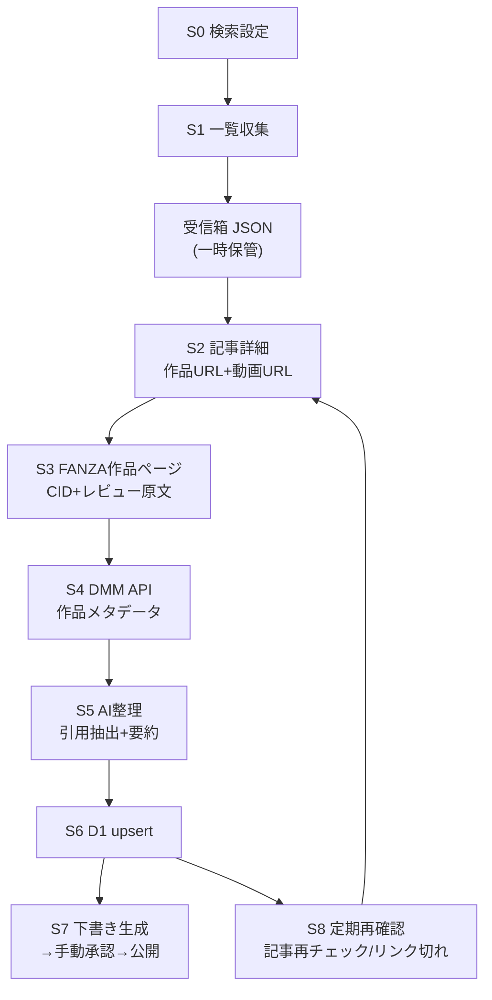
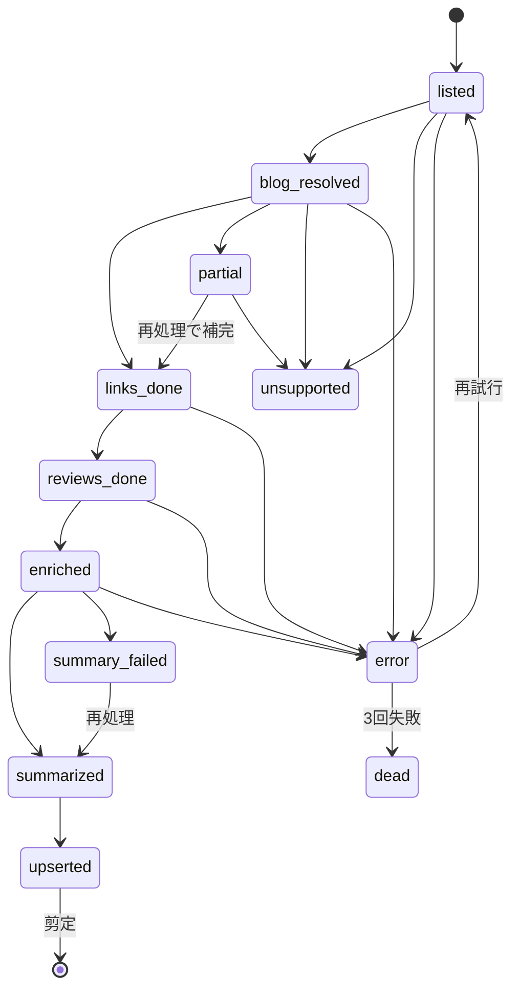

# ブログ自動生成パイプライン 詳細計画書

最終更新: 2026-11-21
元ネタ: `prompt-druft.md`（骨子）
ステータス: 設計合意済み・実装前

---

## 1. 目的とスコープ

### 目的

1. エロタレストの記事から作品情報を収集する
2. FANZA の作品ページから CID とレビュー原文を取得する
3. DMM API で作品メタデータを補完する
4. AI（OpenRouter）でレビューの引用・要約を整理する
5. Cloudflare D1 に正本を保存し、Astro（Cloudflare Workers）でブログを公開する

### スコープ外（この計画では扱わない）

- ブログのデザイン・CSS 設計
- 広告収益施策
- 記事の自動公開（**下書き→手動承認**を前提とする）
- 動画のダウンロード・再ホスト（URL 参照のみ）

---

## 2. 全体像



実行はすべて VPS 上で行い、Python 側が S0〜S6、D1 が正本、Astro/Workers が表示を担当する。

---

## 3. 確定した決定事項

| 項目                         | 決定内容                                                                             |
| ---------------------------- | ------------------------------------------------------------------------------------ |
| 実行ホスト                   | VPS（既存プロジェクトをそのまま使用）                                                |
| 状態管理                     | 受信箱 JSON＋`status` 状態機械。正本は D1（CID をキー）                              |
| レビュー保存                 | 原文は D1 に保持。公開は「引用＋AI要約＋編集コメント」の 3 層                        |
| 引用上限                     | 初期値: 1 作品 3 件 / 1 件 80 文字 / 合計 400 文字（**設定ファイルで変更可**）       |
| AI                           | OpenRouter。**モデルを 2 つ以上並べ、自動フォールバック**                            |
| 公開フロー                   | 下書き → 手動承認 → 公開。更新時も同じ                                               |
| 動画                         | 作品（CID）に集約。1 作品に複数動画。シーンラベルは保持・手動設定                    |
| リンク切れチェック           | 定期実行（初期値 7 日、**設定で変更可**）                                            |
| スクレイピング元と表示の関係 | 元ブログ記事は 1 記事 1 動画。自ブログは **1 作品に複数動画を掲載**                  |
| 実行方式                     | cron / systemd timer ＋ `flock` による**直列実行**（ブラウザプロファイル共有のため） |

---

## 4. ステージ定義

### S0: 検索設定（`src/eroterest-serch-setting.py`）

- 実行頻度: 初期設定時・サイト仕様変更時のみ（通常運用では実行しない）
- 意味: フォームは「表示しない動画サイト」（**チェック＝除外**）。全サイトをチェックした上で対象 7 サイトだけ未チェックにし、実質「7 サイトのみ表示」にする
- 実装: トグルに依存せず、チェックボックスを直接設定してから保存し、保存後に再読込して検証する
- 出力: `.browser-data` への設定永続化
- 注意: 他ステージと同じブラウザプロファイルを使うため同時実行禁止

### S1: 一覧収集（`src/eroterest_list.py`）

- 入力: 検索ワード、`--within-hours`、`--page-delay`
- 出力: 受信箱 JSON に `status: listed` でレコード追加
- 実装済み: ページネーション、時間フィルタ、実行内重複排除、原子保存

### S2: 記事詳細（`src/eroterest_detail.py`）

エロタレスト記事は外部ブログへのリンクを持ち、FANZA・動画URLは**外部ブログ側**に存在する（2ホップ構造）。

**S2a: 外部ブログ URL の解決（エロタレスト記事）**

- 入力: 受信箱の `status: listed`
- 抽出物: `blog_url`（転載元ブログの記事 URL）
- 判別ルール:
  - `eroterest.net` 系ドメインを除外した外部リンクを候補にする
  - 同一 href の複数出現、リンクテキストの「…のページへ行く」「○分」表記を優先
  - 候補がない場合は `unsupported`
- 出力: `status: blog_resolved` ＋ `blog_url`

**S2b: 作品URL・動画URLの抽出（外部ブログ記事）**

- 抽出物:
  - `video_url`: 対応 7 サイト（`txxx.com` / `upornia.com` / `hclips.com` / `hotmovs.com` / `hdzog.com` / `vjav.com` / `senzuri.tube`）のリンク。1 記事 1 件
  - クエリ・フラグメントは保存しない（アフィリエイト識別子を除去）。スラッグは表示用に保持
  - `video_key`: `https://<site>/videos/<id>/`（同一性判定用。ID のみの URL は 404 になるサイトがあるため表示には使わない）
  - `video_site`: 一致したベースサイト名
  - `work_url`: `www.dmm.co.jp/digital/videoa/-/detail/=/cid=<CID>` の**最初の**リンク（末尾トークンは除去）
  - `cid`: `cid=([A-Za-z0-9_]+)` で抽出
- 出力: 見つかった項目は常に保存する
  - 両方揃った場合: `status: links_done`
  - 片方のみ: `status: partial`（`reason` に不足項目を記録）
  - どちらも無し: `status: unsupported`
- `partial` は通常実行ではスキップし、`--retry-partial` 指定時のみ再処理する
- DMM リンクは JS により数秒遅れて挿入されるページがあるため、リンク出現を最大 `--link-wait` 秒（既定6秒）ポーリングしてから抽出する
- 注意: `al.fanza.co.jp` のアフィリエイトリンクはランキング等の別作品を指すため対象外

### S3: FANZA 作品ページ

- 入力: `work_url`
- 抽出物: **CID**、**レビュー原文一式**（評価値・本文・投稿日時・レビュー ID）
- 出力: `cid` 確定、`reviews_raw` に保存、`status: reviews_done`
- 注意: 年齢確認画面、レビューの動的読み込み、レビュー 0 件の作品を考慮

### S4: DMM API 補完

- 入力: `cid`
- 出力: 作品メタデータ（タイトル、メーカー、レーベル、出演者、ジャンル、発売日、画像 URL）
- 生 JSON をスナップショット保存し、`status: enriched`
- 注意: API ID / アフィリエイト ID は `.env` 管理。レート制限は実装時に確認

### S5: AI 整理

- 入力: `reviews_raw`、作品メタデータ
- タスクは **2 つに分離**する
  1. `quote_extraction`: 原文から引用を抜き出す（**改変禁止**）
  2. `review_summary`: レビュー全体の傾向を要約する（自由記述可）
- 出力: `status: summarized`（失敗時は `summary_failed`）

### S6: D1 upsert

- 入力: `status: summarized`（または引用なし公開を許容する場合は `summary_failed`）
- 処理: `works` / `videos` / `article_video_obs` / `sources` / `reviews_raw` / `ai_generations` を upsert
- 出力: D1 反映、`status: upserted`

### S7: 下書き・承認・公開

- 新規作品: `drafts` に新規下書きを生成 → 手動承認 → `works.publish_status = published`
- 既存作品に動画追加: `update_pending` → 更新下書き → 承認 → 反映
- 承認手段: 初期は CLI（`scripts/approve.py`）、後に管理画面

### S8: 定期再確認

- **記事再チェック**: 公開済み作品の元記事を 30 日ごとに再取得（設定可）
  - 記事が別動画を指すようになっていた場合は `article_video_obs` に履歴追記
- **リンク切れチェック**: 動画 URL を 7 日ごとに確認（設定可、バッチ上限あり）
  - 死んだ動画は `is_active = 0` にして表示から除外
- `sources.next_check_at` / `videos.next_link_check_at` で次回日時を管理

---

## 5. データモデル

### 5.1 ローカル受信箱（`data/eroterest-page.json`）

一時的な処理キュー。正本ではない。

| フィールド                                                    | 内容                                                                                                                                               |
| ------------------------------------------------------------- | -------------------------------------------------------------------------------------------------------------------------------------------------- |
| `source_url`                                                  | エロタレスト記事 URL（一意キー）                                                                                                                   |
| `status`                                                      | `listed` / `blog_resolved` / `links_done` / `partial` / `reviews_done` / `enriched` / `summarized` / `upserted` / `unsupported` / `error` / `dead` |
| `attempts`                                                    | 失敗回数（3 回で `dead` へ退避）                                                                                                                   |
| `last_error`                                                  | 直近エラーの要約                                                                                                                                   |
| `blog_url`                                                    | S2a で埋まる（転載元ブログ）                                                                                                                       |
| `video_url` / `video_key` / `video_site` / `work_url` / `cid` | S2b で埋まる（`video_url` はクエリ除去済み）                                                                                                       |
| `stage` / `reason`                                            | 失敗・対象外の発生ステージと理由                                                                                                                   |
| `created_at` / `updated_at`                                   | 時刻                                                                                                                                               |

**削除ルール**

- `status: upserted` かつ D1 反映済み → 次回実行の冒頭で削除
- `attempts < 3` のエラーは保持して再試行、3 回到達で `data/dead/` へ退避
- `in_progress` 相当は開始時刻を記録し、1 時間超で失敗扱いに戻す

### 5.2 D1 スキーマ

```text
works
  cid                TEXT PRIMARY KEY       -- 正規キー
  slug               TEXT UNIQUE            -- 記事 URL 用（後述: 変更困難）
  title              TEXT
  description        TEXT
  maker / label      TEXT
  release_date       TEXT
  genres_json        TEXT
  actresses_json     TEXT
  product_url        TEXT
  package_image_url  TEXT
  publish_status     TEXT   -- draft / published / hidden
  first_published_at / updated_at
  next_source_check_at

videos
  id                 INTEGER PRIMARY KEY
  cid                TEXT REFERENCES works(cid)
  video_key          TEXT UNIQUE            -- https://<site>/videos/<id>/（同一性判定専用。表示・痎通確認には使わない）
  display_url        TEXT                   -- クエリ除去済み表示URL（スラッグ保持。リンク切れチェックもこれを使う）
  site               TEXT                   -- txxx / upornia / ... のベースドメイン
  scene_label        TEXT NULL              -- 序盤/中盤/終盤 など。手動設定
  sort_order         INTEGER NULL           -- 未設定なら first_seen 順
  first_seen_at / last_seen_at
  is_active          INTEGER DEFAULT 1
  next_link_check_at

sources
  id                 INTEGER PRIMARY KEY
  url                TEXT UNIQUE            -- 元記事 URL
  cid                TEXT NULL
  kind               TEXT                   -- detail など
  last_checked_at / next_check_at

article_video_obs
  id                 INTEGER PRIMARY KEY
  source_id          INTEGER REFERENCES sources(id)
  video_id           INTEGER REFERENCES videos(id)
  observed_at        TEXT
  is_current         INTEGER                -- 最新の紐付けフラグ

reviews_raw
  id                 TEXT PRIMARY KEY       -- FANZA レビュー ID（なければハッシュ）
  cid                TEXT
  rating             INTEGER
  body               TEXT
  posted_at / fetched_at

ai_generations
  id                 INTEGER PRIMARY KEY
  cid                TEXT
  task               TEXT                   -- quote_extraction / review_summary
  model              TEXT                   -- 実際に成功したモデル
  prompt_version     TEXT
  input_hash         TEXT                   -- 冪等性キー
  output_json        TEXT
  status / error / created_at

drafts
  id                 INTEGER PRIMARY KEY
  cid                TEXT
  revision_no        INTEGER
  status             TEXT                   -- draft / approved / rejected
  content_json       TEXT                   -- 引用・要約・編集コメント・動画順
  generated_at / approved_at
```

### 5.3 状態機械



---

## 6. 設定ファイル設計

`config/settings.yaml` に集約する。コード変更なしで運用値を変えられる。

```yaml
quotes:
  max_count_per_work: 3
  max_chars_per_quote: 80
  max_total_chars: 400

ai:
  api_key_env: OPENROUTER_API_KEY
  models: # 上から順に試す（例。実際の無料モデルに差し替える）
    - id: "example/free-model-a"
      timeout_s: 60
    - id: "example/free-model-b"
      timeout_s: 60
  retry_per_model: 1

schedules:
  list_interval_minutes: 120
  within_hours: 3
  article_recheck_days: 30
  video_link_check_days: 7
  video_link_check_batch: 50

scraping:
  page_delay_seconds: 2.0
  page_delay_jitter: 0.5
  max_attempts: 3
  timeout_ms: 30000
```

`.env`（秘密情報・値はコミットしない）:

- `OPENROUTER_API_KEY`
- `DMM_API_ID` / `DMM_AFFILIATE_ID`
- `CLOUDFLARE_API_TOKEN` / `CLOUDFLARE_ACCOUNT_ID` / `D1_DATABASE_ID`

### 6.1 後から変更しやすいもの / しにくいもの

**設定ファイルで変更できる（コード修正不要）**

- 引用の件数・文字数・合計上限
- 使用モデルと順序・タイムアウト
- 各種実行間隔（記事再チェック、リンク切れ、一覧収集）
- ウェイト・リトライ回数・バッチ上限

**後から変更しにくいもの（今の設計で吸収済み）**

| 項目                                       | 理由と対策                                                                              |
| ------------------------------------------ | --------------------------------------------------------------------------------------- |
| D1 の主キー設計（CID、動画 URL の UNIQUE） | 変更すると全データ移行が必要。**現在の設計で確定**                                      |
| データの層構造（受信箱／正本／派生）       | 後から統合・分割すると全ステージに影響                                                  |
| レビューの保存粒度                         | **1 レビュー 1 行＋引用は別フィールド**で保存するため、引用ポリシー変更は設定変更で済む |
| 記事 URL（`slug`）                         | SEO に直結。公開前に確定させる                                                          |
| AI 出力のスキーマ                          | Astro の表示コードと結合。変更時は `prompt_version` を上げて再生成                      |

---

## 7. AI フォールバック設計

### 基本動作

1. `config/settings.yaml` の `ai.models` を**上から順に試す**
2. 成功したら採用し、`ai_generations.model` に記録
3. 失敗したら次のモデルへフォールバック
4. 全モデル失敗 → `status: summary_failed` として保存し、後日再処理

### フォールバックのトリガー

- ネットワークエラー・HTTP エラー（429 / 5xx など）
- タイムアウト
- JSON パース失敗（1 回だけ修復プロンプトで再試行 → それでも失敗なら次モデル）
- 空レスポンス・拒否レスポンス

### モデル差し替えの運用

- **設定ファイルの `models` 配列を書き換えるだけ**で反映（コード変更・再デプロイ不要）
- 期間限定無料モデルの終了時は、その行を削除して代替を先頭に追加
- どのモデルが実際に使われたかは `ai_generations` とログで追跡

### 冪等性

- `input_hash`（レビュー原文＋プロンプト版＋スキーマ版のハッシュ）を保存
- 同じ入力で再実行された場合は API を呼ばず既存結果を再利用
- プロンプトを変えたときは `prompt_version` を上げて再生成を明示的に行う

---

## 8. 動画の多段管理

### 前提の整理

- **元ブログ記事**: 1 記事につき 1 動画 URL（一意に定まる）
- **自ブログ**: 1 作品（CID）につき複数の動画を掲載する
- 同じ作品を紹介する別記事が、別シーン（序盤・中盤・終盤など）の動画を指すことがある

### 登録ルール

1. 記事から動画 URL を取得したらクエリ・フラグメントを除去し、`videos.video_key`（`https://<site>/videos/<id>/`）の UNIQUE で重複排除。表示にはスラッグ付きの `display_url` を使う
2. 既存作品（CID 一致）なら動画を追加するだけ。新規作品なら `works` も作成
3. `article_video_obs` に「どの記事がいつどの動画を指したか」を履歴として記録。記事が後から別動画に差し替わっても**過去の観測は消さない**
4. `is_current` で現在の紐付けを表現

### シーンラベルと並び順（保持する）

- `scene_label`（序盤・中盤・終盤など）と `sort_order` は **手動設定**を基本とする
- 初期状態は `NULL`（発見順で表示）
- 下書き承認のタイミングで編集する（承認画面／CLI）
- 将来、記事本文から AI に**候補**を出させることは可能。ただし自動確定はしない

### 更新フロー（「後から序盤を追加」）

1. S8 または通常収集で、公開済み作品に未登録の動画を検出
2. 作品を `update_pending` に変更
3. `drafts` に更新版（revision_no を加算）を生成
4. 手動承認 → `videos` の表示順・ラベルを確定して公開

### リンク切れチェック

- `videos.next_link_check_at` が到来したものを `video_link_check_batch` 件ずつ、**`display_url`** で確認（`video_key` は ID のみで 404・リダイレクトするサイトがある）
- 失敗した動画は `is_active = 0`（記事から除外）。復活したら再度有効化
- 全動画が死んだ作品は `hidden` にして公開停止

---

## 9. エラー・リトライ・冪等性

| レイヤ         | 方針                                                                          |
| -------------- | ----------------------------------------------------------------------------- |
| スクレイピング | 作品・記事単位でエラー隔離。1 件失敗しても全体を止めない。3 回失敗で `dead`   |
| ブラウザ       | `PlaywrightError` / タイムアウトを捕捉し、スクリーンショットを保存            |
| AI             | モデルフォールバック（§7）。全滅時は後日再処理                                |
| D1 書き込み    | `cid` / `video_key` / レビュー ID による upsert（INSERT OR REPLACE 相当）     |
| 実行           | `flock` で多重起動を防止。プロファイル共有のため全ステージ直列                |
| 通知           | ステージごとの成功/失敗件数をログに集計。閾値超過（例: 連続 3 回 0 件）で通知 |

---

## 10. VPS 運用

### 実行

- cron または systemd timer で `scripts/run_pipeline.sh` を定期実行
- `run_pipeline.sh` は `flock -n` で排他制御し、S1 → S2 → S3 → S4 → S5 → S6 → S8 を順に呼ぶ
- 時刻は `Asia/Tokyo`
- ブラウザ格納先は既存どおり `PLAYWRIGHT_BROWSERS_PATH=.browsers`

### ログと保全

- `logs/pipeline-YYYYMMDD.log` に追記、logrotate で 14 日保持
- スクリーンショットは 7 日で削除（容量対策）
- `.env` は `chmod 600`、git 管理外

---

## 11. Astro / Workers / D1 連携

### プロジェクトの所在

ブログのコードは**別プロジェクト** `/home/ubuntu/workspace/astro-blog` に存在する。
本リポジトリ（収集パイプライン）は D1 への書き込みまでを担当し、Astro 側の実装は当該プロジェクトで行う。
D1 スキーマの適用・Astro のルーティング・デプロイ設定は astro-blog 側の構成を確認した上で確定させる。

### 構成

- Astro を Cloudflare Workers にデプロイ、D1 をバインディングで参照
- **初期は SSR を推奨**（D1 更新が即反映され、下書き承認＝即公開になる）
- 作品ページ: `/works/{slug}`、一覧・タグ・出演者ページも用意
- `publish_status = 'published'` の作品のみ表示

### データ移送

- Python（S6）→ **D1 HTTP API** に直接 upsert（`wrangler` 依存なし）
- 大量投入が必要になったら NDJSON → `wrangler d1 import` に切り替え

### 表示上のルール

- 引用は原文ママ・ブロッククォート・出典表記あり
- AI 要約と編集コメントは視覚的に分離
- 引用テキストは HTML エスケープ
- 年齢確認導線・アフィリエイト開示を設置
- 画像は DMM の URL を参照（D1 にバイナリを入れない）

### 承認

- 初期: CLI `scripts/approve.py <cid>` で `drafts.status` を更新
- 将来: 管理画面（認証付き）を追加

---

## 12. 実装マイルストーン

| #   | 内容                                                            | 完了条件                                                                  |
| --- | --------------------------------------------------------------- | ------------------------------------------------------------------------- |
| M1  | 受信箱の `status` 化＋S2（外部ブログ解決→作品URL・動画URL抽出） | 作品URL・CIDは常に保存。動画URLは取得できれば保存（片方のみは `partial`） |
| M2  | S3（CID・レビュー取得）＋S4（DMM API）＋ローカル保存            | レビュー原文と作品メタデータがローカルに揃う                              |
| M3  | `config/settings.yaml`、AI フォールバック、引用・要約生成       | 2 モデル構成で生成でき、片方停止時も継続できる                            |
| M4  | D1 スキーマ＋upsert＋Astro MVP（公開作品のみ表示）              | D1 から作品ページが表示される                                             |
| M5  | 下書き承認フロー、動画追加・更新フロー、シーンラベル編集        | 後から動画を追加して記事更新できる                                        |
| M6  | cron 自動化、S8（記事再チェック・リンク切れ）、通知             | 無人で 1 週間安定稼働                                                     |

---

## 13. リスクと対策

| リスク                            | 対策                                                 |
| --------------------------------- | ---------------------------------------------------- |
| サイトのセレクタ変更で 0 件になる | セレクタも設定ファイル化。0 件連続で通知             |
| FANZA の年齢確認・動的読み込み    | 実装時に実ページで確認。待機条件を明示               |
| 無料モデルの提供終了              | 2 モデルフォールバック＋設定差し替えのみで対応       |
| 引用の権利面                      | 必要最小限・原文保持・出典明示。公開前に方針を再確認 |
| D1 の無料枠                       | 初期規模では問題なし。件数増加時に読み書きを集計     |
| 動画 URL のリンク切れ             | `is_active` 管理＋定期チェック                       |
| ブラウザプロファイルの同時利用    | `flock` による直列実行                               |

---

## 14. 未決事項

1. ~~FANZA 作品ページ URL の抽出手順~~ → **解決済み**: 外部ブログ上の最初の `/digital/videoa/-/detail/=/cid=` リンク（同一ページ内の候補は同一 CID であることを確認）
2. 外部ブログリンクの判別ルールの再現性検証（リンクを持たないブログもある）→ 収集件数の増加で継続確認
3. ~~動画ホストの多様性~~ → **解決済み**: 7 サイトに対応。`senzuri.tube` も検証済み（表示は `/videos/<id>/a/` 形式。ID のみは most-popular へリダイレクトするため表示に使わない）
4. DMM API のレート制限値 → M2 で実測
5. `slug` の生成規則（CID ベースかタイトルベースか）→ M4 前に決定（**変更困難**）
6. 通知手段（メール / Slack / Discord など）→ M6 前に決定
7. 画像の参照方式（DMM 直リンクの規約確認）→ M4 前に確認
8. `astro-blog` の現状 → **確認済み**（§11）。Content Collections との共存・作品ページ URL 設計は M4 前に確定
